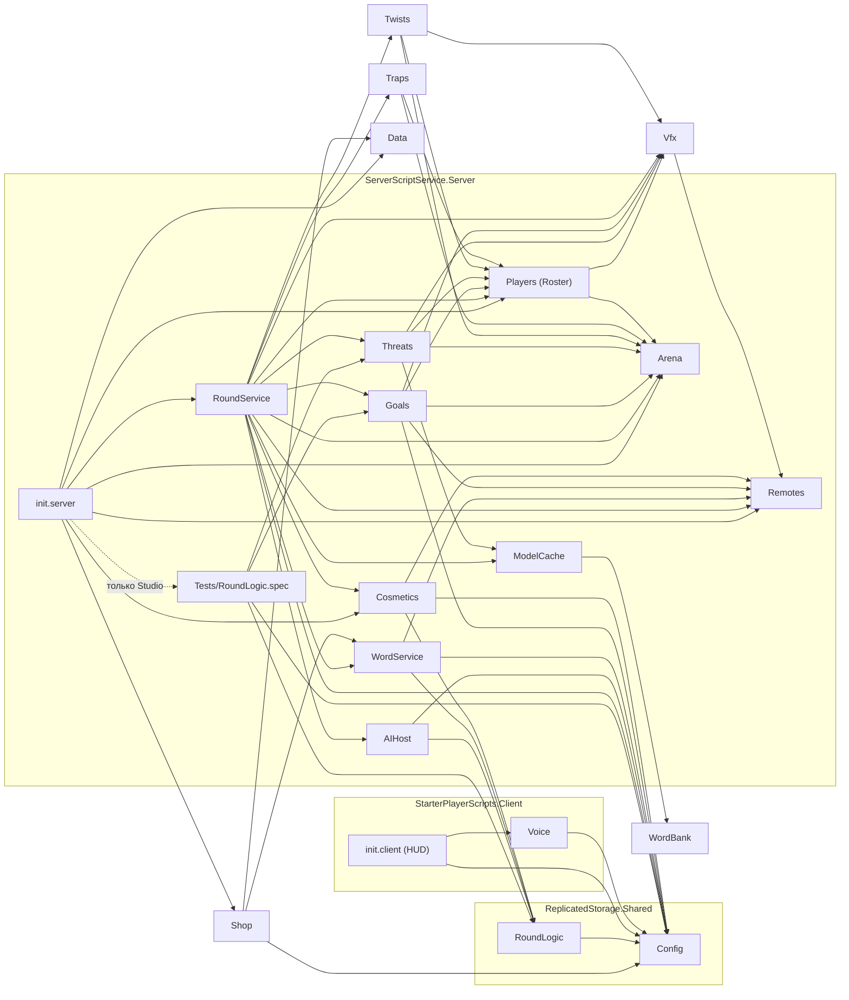
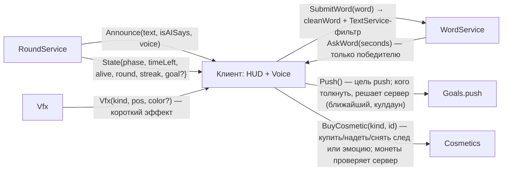
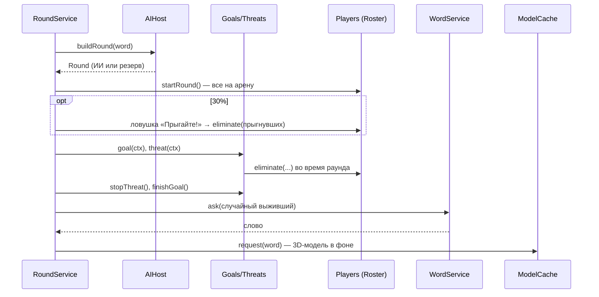

# Карта кода

GitHub рисует эти схемы сам. Обновлять вручную при добавлении модуля или RemoteEvent.

## Кто кого требует (require)

Правило: `Shared` не знает о сервере и клиенте; `Players`/`Arena` — нижний слой сервера, их требуют все, они — никого, кроме друг друга.

## Сеть (RemoteEvent)

## Один раунд

